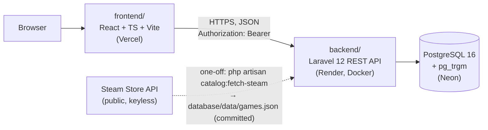
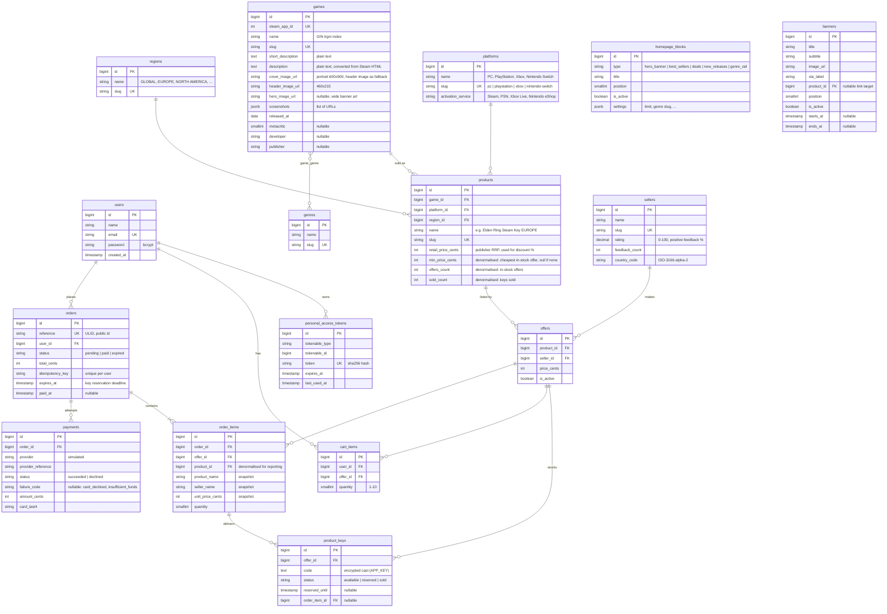

# Architecture

A marketplace for digital game keys in the style of eneba.com. A React SPA calls a versioned Laravel REST API, and the API is backed by PostgreSQL.



| Concern | Decision | Why |
|---|---|---|
| Repo | Monorepo: `backend/`, `frontend/`, `docs/`, `docker-compose.yml` | One clone, one PR per feature across the stack |
| API style | REST, prefixed `/api/v1`, Eloquent API Resources | Simple to consume from React and easy to version |
| Auth | Sanctum **personal access tokens** (Bearer) | Vercel and Render are different sites, so cookie-based SPA auth would be blocked as third-party |
| Search | Postgres `pg_trgm` (trigram similarity + ILIKE) | Tolerates typos without an extra search service to deploy |
| Payments | `PaymentGateway` interface + `SimulatedPaymentGateway` | No real money; swapping in Stripe means one new class |
| Catalog data | Steam Store `appdetails` fetched once into a committed JSON seed | Real titles, descriptions and artwork without an API key; seeding and deploys never call Steam |
| Money | Integer cents, single currency EUR | No float rounding; multi-currency is out of scope |
| Local dev | Postgres in Docker; XAMPP PHP 8.2 (`pdo_pgsql` enabled) | Databases `eneba` (dev) and `eneba_test` (tests, real `pg_trgm`) |

---

## Data model

### Domain shape

Eneba sells **products**, and a product is one game on one platform for one region. For example, *Elden Ring – Steam Key – EUROPE* and *Elden Ring – Xbox Key – GLOBAL* are different products. Several **sellers** compete on each product with **offers**, and each offer holds a stock of **keys**.

```
Game ──< Product (platform × region) ──< Offer (seller, price) ──< ProductKey
```

### ER diagram



The diagram omits `timestamps` and Laravel framework tables (`sessions`, `cache`, `jobs`). `homepage_blocks` and `banners` stand alone, and banners link to products optionally.

### Modelling notes

- **Denormalised product aggregates** (`min_price_cents`, `offers_count`, `sold_count`). The store sorts and filters by "from €X", and computing that as a `MIN()` over offers and keys on every catalog query would be slow. The `ProductStockAggregator` service recomputes these columns inside the same transaction whenever stock changes (reservation, payment, expiry release, seeding).
- **Snapshots on `order_items`.** The name, seller and price are copied at checkout, so later price changes or deleted offers never alter order history.
- **Keys are encrypted at rest** using Laravel's `encrypted` cast. They are only returned to the owner of a **paid** order.
- **Reservations expire lazily.** A key counts as available when `status = 'available'` OR `status = 'reserved' AND reserved_until < now()`. The free tier on Render has no cron worker, so correctness can't depend on a scheduler. A scheduled `orders:expire-pending` command still exists to tidy up rows.
- **Real platforms only.** A game gets a product only for platforms it is actually sold on, e.g. ELDEN RING → PC, PlayStation, Xbox. Steam can't tell us about consoles, so each game's platforms are curated by hand in `database/data/steam-catalog-sources.json`. A console is listed only when the game is currently sold digitally on that console family. Product names follow Eneba's style: `{game} {activation service} Key {REGION}`, e.g. "ELDEN RING PSN Key EUROPE".
- **Integrity in the database.** CHECK constraints cover positive prices, cart quantity 1–10 and order quantities. `enum()` columns become CHECK constraints on Postgres. A key's `status`, `order_item_id` and `reserved_until` must agree: an available key has neither, a reserved key has both, and a sold key has an order item.
- **Seeded data.** Steam supplies the games, genres, descriptions, artwork and retail prices. A seeder generates regions, sellers, offers, fake key codes and plausible `sold_count` values. Steam is credited in the footer and the README.

### Catalog import (`php artisan catalog:fetch-steam`)

1. Read the curated list `database/data/steam-catalog-sources.json`. Each entry has `steam_app_id`, `name` and `platforms`.
2. For each game not yet in `database/data/games.json` (all games with `--fresh`), call `GET store.steampowered.com/api/appdetails?appids={id}&cc=lt&l=english`. The command waits 1.5 s between games. Connection errors, 429s and 5xx responses are retried 3 times (2 s / 5 s / 15 s).
3. Skip anything that isn't a paid game with an EUR price in the Lithuanian store. Also skip apps whose Steam name doesn't match the curated name, which catches a mistyped app ID that would otherwise attach the wrong platforms to another game.
4. Check with `HEAD` requests that `library_600x900_2x.jpg` (the portrait cover) and `library_hero.jpg` exist on Steam's CDN. If not, fall back to the header image and the background image.
5. Convert descriptions to plain text, then write the file atomically after **every** game. If Steam keeps failing, progress is already saved and the command exits non-zero, so running it again resumes where it stopped. Games removed from the source list are dropped from the output.

Images are hotlinked from `*.steamstatic.com` (allowed in the CSP) rather than committed to the repo.

---

## Indexes

Primary keys and the index Postgres creates for every `UNIQUE` constraint are implied. Laravel's `foreignId()->constrained()` does **not** create an index on Postgres, so FK indexes are listed explicitly.

| Table | Index | Type | Serves |
|---|---|---|---|
| games | `name gin_trgm_ops` | GIN (pg_trgm) | Typo-tolerant and partial search (`%`, `<%`, `ILIKE`) |
| games | `slug` | UNIQUE | Lookups |
| games | `steam_app_id` | UNIQUE | Idempotent re-import |
| games | `released_at` | B-tree | Sort by release date, New releases block |
| game_genre | `(game_id, genre_id)` | PK | Genre membership |
| game_genre | `genre_id` | B-tree | Filter by genre |
| products | `slug` | UNIQUE | Product page |
| products | `(game_id, platform_id, region_id)` | UNIQUE | One product per edition; also serves `game_id` lookups ("other editions") |
| products | `(platform_id, min_price_cents)` | B-tree | Platform filter + price sort |
| products | `(region_id)` | B-tree | Region filter |
| products | `(min_price_cents) WHERE min_price_cents IS NOT NULL` | Partial B-tree | Price range filter / sort over in-stock products |
| products | `sold_count` | B-tree | Best sellers block, "Popularity" sort (a B-tree can be scanned backwards, so `DESC` needs no separate index) |
| offers | `(product_id, seller_id)` | UNIQUE | One offer per seller per product |
| offers | `(product_id, price_cents) WHERE is_active` | Partial B-tree | Offers on the product page, cheapest first |
| offers | `seller_id` | B-tree | FK |
| product_keys | `(offer_id, status, reserved_until)` | B-tree | Stock counts and `FOR UPDATE SKIP LOCKED` key picking |
| product_keys | `order_item_id` | B-tree | Showing keys on an order |
| cart_items | `(user_id, offer_id)` | UNIQUE | Upsert on add-to-cart |
| cart_items | `offer_id` | B-tree | FK |
| orders | `reference` | UNIQUE | Public order URLs |
| orders | `(user_id, idempotency_key)` | UNIQUE | Checkout idempotency |
| orders | `(user_id, created_at)` | B-tree | Order history, newest first |
| orders | `(expires_at) WHERE status = 'pending'` | Partial B-tree | Expiry sweep |
| order_items | `order_id`, `offer_id`, `product_id` | B-tree | FKs |
| payments | `order_id` | B-tree | FK |
| homepage_blocks | `(is_active, position)` | B-tree | Layout query |
| banners | `(is_active, position)` | B-tree | Hero banner block |
| personal_access_tokens | `token` (unique), `(tokenable_type, tokenable_id)` | — | Created by Sanctum's migration |

The `pg_trgm` extension is enabled by the first migration (`CREATE EXTENSION IF NOT EXISTS pg_trgm`). Neon supports it. Laravel's schema builder can't express GIN operator classes or partial indexes, so those few use `DB::statement()` inside the migration that creates the table.

---

## Search

All three entry points, the header autocomplete, the `/store?q=` results page and the store search box, use one query object, `ProductSearch`:

1. Normalise the input: trim it, collapse whitespace, cap it at 100 characters.
2. Match `games.name ILIKE %q%` (partial names), **or** `q <% games.name` (word similarity, which tolerates typos such as *"eldn ring"* or *"witchr 3"*).
3. Rank: exact prefix match first, then `word_similarity(q, games.name)` descending, then `sold_count`.
4. The similarity threshold is set with `SET LOCAL pg_trgm.word_similarity_threshold = 0.3` inside the query's transaction. `SET LOCAL` keeps it safe behind Neon's transaction-mode connection pooler.

When `q` is present the default sort is `relevance`. Otherwise it is `popularity`.

---

## Checkout & key delivery

```mermaid
sequenceDiagram
    participant FE as React
    participant API as Laravel
    participant DB as Postgres
    FE->>API: POST /checkout (Idempotency-Key)
    API->>DB: BEGIN
    API->>DB: existing order for (user, key)? → return it
    API->>DB: per cart line: SELECT keys ... FOR UPDATE SKIP LOCKED LIMIT qty
    alt not enough keys
        API->>DB: ROLLBACK
        API-->>FE: 409 + which lines are short
    else
        API->>DB: mark keys reserved (15 min), create order + items (price snapshot)
        API->>DB: refresh product aggregates, COMMIT
        API-->>FE: 201 order {status: pending, expires_at}
    end
    FE->>API: POST /orders/{ref}/pay (card)
    API->>DB: BEGIN; SELECT order FOR UPDATE
    Note over API: already paid → 200 (no second charge)<br/>expired → 410
    API->>API: PaymentGateway::charge()
    alt succeeded
        API->>DB: keys → sold, order → paid, sold_count++, clear cart, COMMIT
        API-->>FE: 200 order with keys
    else declined
        API->>DB: record payment attempt, COMMIT (order stays pending)
        API-->>FE: 402 {failure_code}
    end
```

`SKIP LOCKED` means two buyers racing for the last key never block each other and never receive the same key. One gets it and the other gets a 409.

**Simulated test cards** (Luhn-validated, any future expiry, any 3-digit CVC):

| Card number | Result |
|---|---|
| `4242 4242 4242 4242` | Success |
| `4000 0000 0000 0002` | Declined: `card_declined` |
| `4000 0000 0000 9995` | Declined: `insufficient_funds` |

---

## Authentication & token storage

- `POST /auth/register` and `POST /auth/login` return a Sanctum personal access token, which expires after 7 days (`sanctum.expiration`). `POST /auth/logout` revokes it on the server.
- The SPA stores the token in **`localStorage`** and an Axios interceptor sends it as `Authorization: Bearer <token>`. On a `401` the interceptor clears the token and redirects to `/login?redirect=…`.
- CORS allows only the frontend origin (`FRONTEND_URL`). No credentials or cookies are involved.

**The XSS trade-off.** Any JavaScript running on the page can read `localStorage`, so a single XSS bug would let an attacker *steal* the token and use it elsewhere until it expires. An `HttpOnly` cookie can't be read by JS. However, XSS can still make authenticated requests from inside the page in either model, so preventing XSS is the real defence whichever storage we pick. Mitigations:

- React escapes all output. There is no `dangerouslySetInnerHTML`, and Steam descriptions are converted to plain text during the catalog import.
- A strict Content-Security-Policy on Vercel (`script-src 'self'`) blocks injected and third-party scripts.
- Tokens are short-lived and revoked on logout.

Memory-only storage would be safer, but the user would be logged out on every refresh. The cookie alternative would need a Vercel `/api` rewrite proxy to make the API same-origin. Both are documented as possible upgrades.

---

## REST API (`/api/v1`)

All responses are JSON. Collections use `{ data, links, meta }` (Laravel pagination). Validation errors return `422 { message, errors }`. Money is always `{ amount_cents, currency: "EUR" }`, and the frontend formats it with `Intl.NumberFormat`.

🔒 = requires `Authorization: Bearer <token>`.

### Auth

| Method | Path | Body / Query | Success | Errors |
|---|---|---|---|---|
| POST | `/auth/register` | `name, email, password, password_confirmation` | `201 { user, token }` | 422 |
| POST | `/auth/login` | `email, password` | `200 { user, token }` | 422 invalid credentials, 429 (5/min per email+IP) |
| POST | `/auth/logout` 🔒 | — | `204` | 401 |
| GET | `/auth/me` 🔒 | — | `200 { user }` | 401 |

### Catalog & search

| Method | Path | Body / Query | Success |
|---|---|---|---|
| GET | `/products` | `q`, `platform[]`, `region[]`, `genre[]`, `price_min`, `price_max` (EUR), `in_stock` (bool, default true), `sort` = `relevance\|popularity\|price_asc\|price_desc\|release_date\|name`, `page`, `per_page` (≤ 48) | `200` paginated product cards (name, slug, cover, platform, region, `from` price, discount %, offers_count) |
| GET | `/products/{slug}` | — | `200` product + game (description, genres, screenshots) + **offers** (cheapest first: seller, rating, price, stock) + other editions of the same game |
| GET | `/catalog/filters` | Same filter params as `/products` | `200 { platforms[], regions[], genres[] }` each with `count` under the current filters, plus `price: { min, max }` |
| GET | `/search/suggestions` | `q` (≥ 2 chars) | `200` up to 8 product cards for the header autocomplete (60/min per IP) |

### Homepage

| Method | Path | Success |
|---|---|---|
| GET | `/homepage` | `200` ordered layout: `[{ id, type, title }]` from active `homepage_blocks` |
| GET | `/homepage/blocks/{id}` | `200 { id, type, title, data }`. `data` comes from the block's own provider: `hero_banner` → `banners` table, `best_sellers` → `products.sold_count`, `deals` → largest `retail_price` vs `min_price` discount, `new_releases` → `games.released_at`, `genre_rail` → genre from `settings` |

Each block is fetched separately, so blocks load in parallel and a failing block only hides itself. On the backend, each `type` maps to a class implementing `HomepageBlockProvider`, registered in a `HomepageBlockRegistry`. The frontend maps `type` to a component and contains no hardcoded content.

### Cart 🔒

Guests keep a cart in `localStorage`. It is sent to `/cart/merge` right after login or registration.

| Method | Path | Body | Success | Errors |
|---|---|---|---|---|
| GET | `/cart` | — | `200 { items[{ offer, product, seller, quantity, unit_price, line_total, available_stock }], total }` | |
| POST | `/cart/items` | `offer_id, quantity` | `200` cart (adds to an existing line) | 422 inactive offer / over stock / qty > 10 |
| PATCH | `/cart/items/{offer}` | `quantity` | `200` cart | 404, 422 |
| DELETE | `/cart/items/{offer}` | — | `200` cart | 404 |
| POST | `/cart/merge` | `items[{ offer_id, quantity }]` | `200` cart (quantities summed, clamped to stock and 10) | 422 |

### Checkout & orders 🔒

| Method | Path | Body / Headers | Success | Errors |
|---|---|---|---|---|
| POST | `/checkout` | Header `Idempotency-Key: <uuid>` | `201` pending order (`reference`, items, total, `expires_at`). A repeated key returns `200` with the same order | 422 empty cart, 409 `{ shortages[] }` |
| POST | `/orders/{reference}/pay` | `card_number, expiry_month, expiry_year, cvc, cardholder_name` | `200` paid order **with keys** (idempotent if already paid) | 402 `{ failure_code }`, 410 expired, 403 not owner, 422 |
| GET | `/orders` | `page` | `200` paginated order history (newest first) | |
| GET | `/orders/{reference}` | — | `200` order. Keys are included only when `status = paid` | 403 not owner, 404 |

### Ops

| Method | Path | Purpose |
|---|---|---|
| GET | `/up` | Laravel health route, used by Render's health check (outside `/api/v1`, no DB access, so it stays green while Neon wakes) |
| GET | `/api/v1/ping` | Full-stack check: `200 { status, environment, database: { connected, server_time, latency_ms } }`, or `503` if the DB is unreachable |

---

## Frontend routes

| Route | Page | Auth |
|---|---|---|
| `/` | Homepage (block-driven) | |
| `/store` | Catalog + filters + sort. `?q=` turns it into search results, and all filter state lives in the URL | |
| `/product/:slug` | Product page + offer comparison | |
| `/cart` | Cart (guest or server) | |
| `/checkout/:reference` | Payment form for a pending order | 🔒 |
| `/orders`, `/orders/:reference` | Order history, order detail with keys | 🔒 |
| `/login`, `/register` | Auth (honours `?redirect=`) | |

---

## Backend layout (planned)

```
backend/app/
  Http/Controllers/Api/V1/   thin controllers
  Http/Requests/             FormRequests (validation)
  Http/Resources/            API Resources (response shape)
  Models/
  Services/Catalog/          ProductSearch, ProductStockAggregator
  Services/Checkout/         CheckoutService (reserve), OrderPaymentService (pay)
  Services/Payments/         PaymentGateway (interface), SimulatedPaymentGateway, PaymentResult
  Services/Homepage/         HomepageBlockProvider (interface), HomepageBlockRegistry, Blocks/*
  Services/Catalog/          SteamStoreClient, SteamGameNormalizer (catalog import)
  Enums/                     GamePlatform (pc, playstation, xbox, nintendo-switch)
  Console/Commands/          FetchSteamCatalog, ExpirePendingOrders
backend/database/data/steam-catalog-sources.json   curated app IDs + real platforms
backend/database/data/games.json                   committed Steam snapshot (generated)
```

## Out of scope (deliberately)

Seller accounts and dashboards, an admin UI, reviews, wishlists, multi-currency and i18n, email verification and password reset, and real email delivery (keys are shown in the UI and logged).
