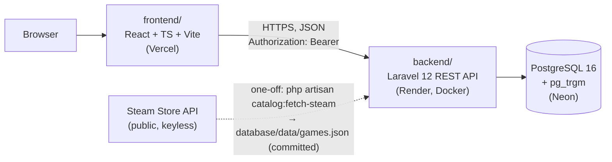
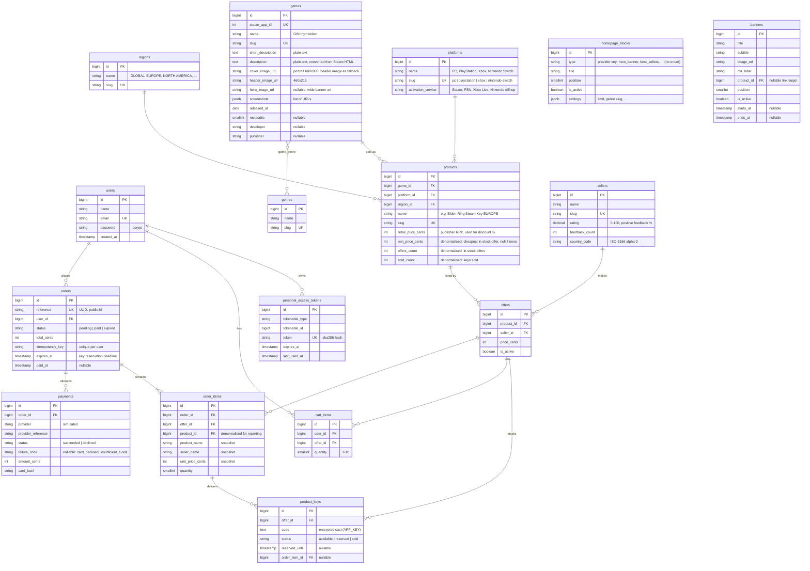

# Architecture

A marketplace for digital game keys in the style of eneba.com. A React SPA calls a versioned Laravel REST API, and the API is backed by PostgreSQL.

**Live:**
- Frontend: https://eneba-marketplace-coral.vercel.app
- API: https://eneba-marketplace-api-b54c.onrender.com. Render added the `-b54c` suffix, so the service name in `render.yaml` and the hostname differ.



| Concern | Decision | Why |
|---|---|---|
| Repo | Monorepo: `backend/`, `frontend/`, `docs/`, `docker-compose.yml` | One clone, one PR per feature across the stack |
| API style | REST, prefixed `/api/v1`, Eloquent API Resources | Simple to consume from React and easy to version |
| Auth | Sanctum **personal access tokens** (Bearer) | Vercel and Render are different sites, so cookie-based SPA auth would be blocked as third-party |
| Search | Postgres `pg_trgm` (trigram similarity + ILIKE) | Tolerates typos without an extra search service to deploy |
| Payments | `PaymentGateway` interface + `SimulatedPaymentGateway` | No real money; swapping in Stripe means one new class |
| Catalog data | Steam Store `appdetails` fetched once into a committed JSON seed | Real titles, descriptions and artwork without an API key; seeding and deploys never call Steam |
| Money | Integer cents, single currency EUR | No float rounding; multi-currency is out of scope |
| Local dev | Postgres in Docker; XAMPP PHP 8.2 (`pdo_pgsql` enabled) | Databases `eneba` (dev) and `eneba_test` (tests, real `pg_trgm`) |
| DB connections | App: Neon's **pooled** endpoint (`DB_URL`) with **emulated prepares**. Migrations and seeding: the **direct** endpoint (`DB_MIGRATION_URL`, connection `pgsql_direct`) | Server-side prepared statements silently break transactions behind PgBouncer; see [Neon's pooler and PDO](#neons-pooler-and-pdo) |

---

## Data model

### Domain shape

Eneba sells **products**, and a product is one game on one platform for one region. For example, *Elden Ring – Steam Key – EUROPE* and *Elden Ring – Xbox Key – GLOBAL* are different products. Several **sellers** compete on each product with **offers**, and each offer holds a stock of **keys**.

```
Game ──< Product (platform × region) ──< Offer (seller, price) ──< ProductKey
```

### ER diagram



The diagram omits `timestamps` and Laravel framework tables (`sessions`, `cache`, `jobs`). `homepage_blocks` and `banners` stand alone, and banners link to products optionally.

### Modelling notes

- **Denormalised product aggregates** (`min_price_cents`, `offers_count`, `sold_count`). The store sorts and filters by "from €X", and computing that as a `MIN()` over offers and keys on every catalog query would be slow. See [Consistency](#consistency-product-aggregates--reservation-expiry) below.
- **Snapshots on `order_items`.** The name, seller and price are copied at checkout, so later price changes or deleted offers never alter order history.
- **Keys are encrypted at rest** using Laravel's `encrypted` cast. They are only returned to the owner of a **paid** order.
- **Real platforms only.** A game gets a product only for platforms it is actually sold on, e.g. ELDEN RING → PC, PlayStation, Xbox. Steam can't tell us about consoles, so each game's platforms are curated by hand in `database/data/steam-catalog-sources.json`. A console is listed only when the game is currently sold digitally on that console family. Product names follow Eneba's style: `{game} {activation service} Key {REGION}`, e.g. "ELDEN RING PSN Key EUROPE".
- **Integrity in the database.** CHECK constraints cover positive prices, cart quantity 1–10 and order quantities. `enum()` columns become CHECK constraints on Postgres. A key's `status`, `order_item_id` and `reserved_until` must agree: an available key has neither, a reserved key has both, and a sold key has an order item.
- **Seeded data.** Steam supplies the games, genres, descriptions, artwork and retail prices. A seeder generates regions, sellers, offers, fake key codes and plausible `sold_count` values. Steam is credited in the footer and the README.

### Catalog import (`php artisan catalog:fetch-steam`)

1. Read the curated list `database/data/steam-catalog-sources.json`. Each entry has `steam_app_id`, `name` and `platforms`.
2. For each game not yet in `database/data/games.json` (all games with `--fresh`), call `GET store.steampowered.com/api/appdetails?appids={id}&cc=lt&l=english`. The command waits 1.5 s between games. Connection errors, 429s and 5xx responses are retried 3 times (2 s / 5 s / 15 s).
3. Skip anything that isn't a paid game with an EUR price in the Lithuanian store. Also skip apps whose Steam name doesn't match the curated name, which catches a mistyped app ID that would otherwise attach the wrong platforms to another game.
4. Check with `HEAD` requests that `library_600x900_2x.jpg` (the portrait cover) and `library_hero.jpg` exist on Steam's CDN. If not, fall back to the header image and the background image.
5. Convert descriptions to plain text, then write the file atomically after **every** game. If Steam keeps failing, progress is already saved and the command exits non-zero, so running it again resumes where it stopped. Games removed from the source list are dropped from the output.

Images are hotlinked from `*.steamstatic.com` (allowed in the CSP) rather than committed to the repo.

### Consistency: product aggregates & reservation expiry

**Recompute, don't increment.** `ProductStockAggregator::refresh($productIds)` recalculates all three columns from the source rows (offers and keys) in one `UPDATE … FROM (stats)` statement:

- a key is **in stock** when it is `available`, or `reserved` with `reserved_until < now()`. That rule is defined once, in `ProductKey::inStockSql()` and the `ProductKey::inStock()` scope, and shared by these aggregates and the product page's per-offer stock;
- `min_price_cents` = the cheapest active offer with stock (`null` if none);
- `offers_count` = the number of such offers;
- `sold_count` = the number of keys sold.

Because nothing is `+= 1`, running it twice, or for every product at once, always gives the same, correct result. As a consequence, the seeder must create real sold keys (seeded past orders) rather than writing a made-up `sold_count`.

**Where it's called.** It runs inside the same database transaction as every write that changes stock:

| Write | Products refreshed |
|---|---|
| Checkout reserves keys | Products in the cart |
| Payment succeeds (keys → `sold`) | Products in the order |
| Expired reservations are released (sweep below) | Products of the released keys |
| Seeding / key import / offer price or `is_active` change | Affected products |

**Failure halfway.** If anything in the transaction fails (a payment exception, a constraint violation, a lost connection), the stock change and the aggregate update roll back together, so a failure can't leave them out of step. Drift can only come from writes that bypass the service (manual SQL, a future code path that forgets to call it).

**Concurrent writers.** `refresh()` first locks the product rows (`SELECT … FOR UPDATE`, ordered by id to avoid deadlocks), and only then runs the `UPDATE`. Under Postgres' default READ COMMITTED isolation, each statement sees a fresh snapshot. A concurrent checkout touching the same product has therefore either committed (and its keys are counted) or is waiting on the lock. Computing first and locking second could overwrite newer stats with stale ones.

**Repairing drift.** `php artisan catalog:recalculate-product-stats [--dry-run]` lists drifted products (stored → actual) and fixes them. Only rows that differ are written, and the command is safe to run at any time.

**Releasing expired reservations without cron.** Render's free tier has no scheduler or queue worker, so expiry is designed in two layers:

1. **Lazy expiry keeps money and keys correct.** Checkout picks keys with `status = 'available' OR (status = 'reserved' AND reserved_until < now())` using `FOR UPDATE SKIP LOCKED`, so an expired hold is free stock the moment it expires, with no background job involved. Payment locks the order row and rejects it once `expires_at` has passed (`410`). It then marks keys sold with `WHERE order_item_id = <this order's items> AND status = 'reserved'` and requires the affected row count to equal the quantity, otherwise it rolls back. A late payment can therefore never take keys another buyer has already claimed, and a key is never sold twice.
2. **A sweep keeps stored state tidy.** Lazy expiry alone leaves two cosmetic gaps: orders stay `pending` in the database, and product aggregates show an offer as sold out until something recomputes them. `ReleaseExpiredReservations` fixes both in one transaction: pending orders past `expires_at` → `expired`, their reserved keys → `available`, then a refresh of the affected products. It runs:
   - at the start of every checkout;
   - on catalog reads, throttled to at most once a minute (a cache lock), which is cheap thanks to the partial index on pending `expires_at`;
   - from `routes/console.php` every minute wherever a scheduler exists (`php artisan schedule:work` locally);
   - optionally from a free external pinger (e.g. a GitHub Actions cron calling a token-protected endpoint), which is not needed for correctness.
   
   While the Render instance sleeps nobody can see stale data, and the first request after it wakes runs the sweep. Order API responses also report a pending order past `expires_at` as `expired`, even before the sweep has written it.

---

## Indexes

Primary keys and the index Postgres creates for every `UNIQUE` constraint are implied. Laravel's `foreignId()->constrained()` does **not** create an index on Postgres, so FK indexes are listed explicitly.

| Table | Index | Type | Serves |
|---|---|---|---|
| games | `search_name gin_trgm_ops` | GIN (pg_trgm) | Word-prefix (`LIKE '%q%'` pre-filter) and fuzzy (`<%`) search |
| games | `search_tokens` | GIN (array) | Exact word/acronym containment (`@>`), e.g. `gta 5`, `rdr2` |
| games | `slug` | UNIQUE | Lookups |
| games | `steam_app_id` | UNIQUE | Idempotent re-import |
| games | `released_at` | B-tree | Sort by release date, New releases block |
| game_genre | `(game_id, genre_id)` | PK | Genre membership |
| game_genre | `genre_id` | B-tree | Filter by genre |
| products | `slug` | UNIQUE | Product page |
| products | `(game_id, platform_id, region_id)` | UNIQUE | One product per edition; also serves `game_id` lookups ("other editions") |
| products | `(platform_id, min_price_cents)` | B-tree | Platform filter + price sort |
| products | `(region_id)` | B-tree | Region filter |
| products | `(min_price_cents) WHERE min_price_cents IS NOT NULL` | Partial B-tree | Price range filter / sort over in-stock products |
| products | `sold_count` | B-tree | Best sellers block, "Popularity" sort (a B-tree can be scanned backwards, so `DESC` needs no separate index) |
| offers | `(product_id, seller_id)` | UNIQUE | One offer per seller per product |
| offers | `(product_id, price_cents) WHERE is_active` | Partial B-tree | Offers on the product page, cheapest first |
| offers | `seller_id` | B-tree | FK |
| product_keys | `(offer_id, status, reserved_until)` | B-tree | Stock counts and `FOR UPDATE SKIP LOCKED` key picking |
| product_keys | `order_item_id` | B-tree | Showing keys on an order |
| cart_items | `(user_id, offer_id)` | UNIQUE | Upsert on add-to-cart |
| cart_items | `offer_id` | B-tree | FK |
| orders | `reference` | UNIQUE | Public order URLs |
| orders | `(user_id, idempotency_key)` | UNIQUE | Checkout idempotency |
| orders | `(user_id, created_at)` | B-tree | Order history, newest first |
| orders | `(expires_at) WHERE status = 'pending'` | Partial B-tree | Expiry sweep |
| order_items | `order_id`, `offer_id`, `product_id` | B-tree | FKs |
| payments | `order_id` | B-tree | FK |
| homepage_blocks | `(is_active, position)` | B-tree | Layout query |
| banners | `(is_active, position)` | B-tree | Hero banner block |
| personal_access_tokens | `token` (unique), `(tokenable_type, tokenable_id)` | — | Created by Sanctum's migration |

The `pg_trgm` extension is enabled by the first migration (`CREATE EXTENSION IF NOT EXISTS pg_trgm`). Neon supports it. Laravel's schema builder can't express GIN operator classes or partial indexes, so those few use `DB::statement()` inside the migration that creates the table.

---

## Search

The store (`/products?q=`) and the header autocomplete (`/search/suggest?q=`) share `GameSearch` (in `Services/Search`). Search works on **games**: the store then lists every product of the matching games, and autocomplete shows one entry per game.

**Why trigrams alone aren't enough.** Measured on the seeded catalog:

| Query | Best trigram match | Wanted | Why |
|---|---|---|---|
| `eldn ring` | ELDEN RING (word_similarity 0.615) | ELDEN RING | fine |
| `cyberpnk` | Cyberpunk 2077 (0.667) | Cyberpunk 2077 | fine |
| `wichter` | Monster Hunter Wilds (0.50) | The Witcher 3 | swapped letters destroy most shared trigrams |
| `gta 5` | GTFO (0.33) | Grand Theft Auto V | an abbreviation plus a Roman numeral share no letters with the name |

Search therefore has three layers.

**1. Search columns** (`GameSearchText`), derived from the name:
- **`search_name`** is the name lowercased, with accents and ™/® removed, punctuation turned into spaces and Roman numerals II–X turned into digits ("Grand Theft Auto V Enhanced" → `grand theft auto 5 enhanced`). It has a GIN trigram index.
- **`search_tokens text[]`** holds the name's words plus initial-letter acronyms of 3 or more characters, in digit and Roman form: `gta`, `gta5`, `gtav`, `rdr2`, `bg3`, `kcd2`. It has a GIN index.
- **How they're kept current:** a `Game::saving` hook fills them, the seeder fills them in its bulk insert, and the migration backfilled existing rows.

**2. Typo correction per word** (`QueryCorrector`) runs before the SQL, using PHP's `levenshtein()` against the catalog vocabulary. Levenshtein distance counts single-letter insertions, deletions and substitutions.
- **Allowed edits:** 1 for words of 4–5 characters, 2 for 6 or more. Words of 1–3 characters and numbers are never corrected.
- **Partial words aren't corrected:** a word that is the start of a vocabulary word (`cyber`) is left for prefix matching.
- **Ties** prefer the same first letter, then the closer length.
- Examples: `wichter` → `witcher`, `eldn` → `elden`, `cyberpnk` → `cyberpunk`.

**3. Tiered ranking.** Each matching game gets a tier, and results sort by tier first:

| Tier | Rule (corrected query) | Example |
|---|---|---|
| 4 | exact name | `eldn ring` → `elden ring` |
| 3 | name starts with the query | `red dead`, `cyber` |
| 2 | query starts at a word boundary, **or** every query word is in `search_tokens` | `witcher` in "the **witcher** 3 …", `gta 5`, `rdr2` |
| 1 | fuzzy only: `query <% search_name` (word_similarity ≥ **0.6**, pg_trgm's default) | multiple typos the corrector didn't fix |

**Order within a tier:**
- **`word_similarity`:** how well the query matches the closest stretch of the name.
- **Then `similarity`:** overlap with the whole name, so closer and shorter names win. "Fallout 4" (1.0) beats "Fallout 76" (0.615) for `fallout 4`.
- **Then sales.**

**Why 0.6.** After correction, real matches score 0.6–1.0, and the worst noise measured was 0.5. 0.6 is also the default threshold for the `<%` operator, which can use the trigram index. Keeping the default means there's no `SET` to manage behind Neon's transaction-mode pooler.

**Short queries:**

| Query length (after normalizing) | Behaviour |
|---|---|
| under 2 characters | ignored: the listing shows unfiltered results, suggest returns `[]` |
| 2–3 characters | tiers 2–4 only, with no correction and no fuzzy tier, because 2–3 letters produce too few trigrams to compare reliably. `re` → Resident Evil, Red Dead, Ready or Not; `gta` matches by acronym |

**Response metadata.** Both endpoints return `query: { original, corrected }`, with `corrected` set to `null` when nothing changed. The UI can then show "Showing results for *witcher*". With `q`, the default sort is `relevance`; `sort=relevance` without `q` falls back to popularity. Facet counts always apply the search.

**Vocabulary cache.** The vocabulary (every distinct `search_tokens` word, a few hundred) is read only when a query word might need correcting. It's cached forever and cleared on `Game` saved/deleted events and after seeding.

**Cache store matters.** Measured per autocomplete request with the vocabulary cached:

| Cache store | Queries per request |
|---|---|
| `database` | about 10: about 6 for the rate limiter, plus cache reads, plus the 1 search query |
| `file` | **1** |

Render therefore uses `CACHE_STORE=file`. That's fine for one instance; several instances would need Redis so that a game save clears every instance's cache.

**Known limitation:** a mixed query like `elden ring xbox` still finds ELDEN RING, but only through the fuzzy tier. Mapping platform words onto the platform filter is left out on purpose.

---

## Checkout & key delivery

```mermaid
sequenceDiagram
    participant FE as React
    participant API as Laravel
    participant DB as Postgres
    FE->>API: POST /checkout (Idempotency-Key)
    API->>DB: BEGIN
    API->>DB: existing order for (user, key)? → return it
    API->>DB: per cart line: SELECT keys ... FOR UPDATE SKIP LOCKED LIMIT qty
    alt not enough keys
        API->>DB: ROLLBACK
        API-->>FE: 409 + which lines are short
    else
        API->>DB: mark keys reserved (15 min), create order + items (price snapshot)
        API->>DB: refresh product aggregates, COMMIT
        API-->>FE: 201 order {status: pending, expires_at}
    end
    FE->>API: POST /orders/{ref}/pay (card)
    API->>DB: BEGIN; SELECT order FOR UPDATE
    Note over API: already paid → 200 (no second charge)<br/>expired → 410
    API->>API: PaymentGateway::charge()
    alt succeeded
        API->>DB: keys → sold, order → paid, sold_count++, clear cart, COMMIT
        API-->>FE: 200 order with keys
    else declined
        API->>DB: record payment attempt, COMMIT (order stays pending)
        API-->>FE: 402 {failure_code}
    end
```

`SKIP LOCKED` means two buyers racing for the last key never block each other and never receive the same key. One gets it and the other gets a 409.

**Simulated test cards** (Luhn-validated, any future expiry, any 3-digit CVC):

| Card number | Result |
|---|---|
| `4242 4242 4242 4242` | Success |
| `4000 0000 0000 0002` | Declined: `card_declined` |
| `4000 0000 0000 9995` | Declined: `insufficient_funds` |

---

## Authentication & token storage

- `POST /auth/register` and `POST /auth/login` return a Sanctum personal access token with its own `expires_at`, 7 days by default (`AUTH_TOKEN_TTL_MINUTES`, read from `config/auth.php`). Sanctum rejects an expired token with `401`. `POST /auth/logout` deletes only the token that made the request, so other devices stay signed in.
- **Passwords:** at least 8 characters with at least one letter and one number (`Password::min(8)->letters()->numbers()`), and confirmed. There's no "have I been pwned" lookup, which keeps the API from depending on an outside service. Emails are trimmed and lowercased before the `unique:users` check, so `Demo@Example.com` can't register twice.
- **No account enumeration:**
  - An unknown email and a wrong password return the same `422` with the same message (`auth.failed`).
  - Both take the same time: when the email doesn't exist, `Hash::check` still runs against a fixed bcrypt hash of the same cost.
- **Rate limits:**
  - Login allows 5 failed attempts per email + IP. The next one gets `429` with `Retry-After`, even if the password is right. A successful login resets the counter.
  - On top of that, register and login share a limit of 20 requests a minute per IP (the `auth` limiter), which slows credential stuffing across many emails.
- **Unauthenticated API requests** always get a JSON `401 {"message":"Unauthenticated."}`, never a redirect, even when there's no `Accept` header (`bootstrap/app.php`).
- **SPA side:**
  - `lib/auth/token.ts` keeps the token in `localStorage`, with an in-memory fallback when storage is blocked. `lib/api/client.ts` sends it as `Authorization: Bearer <token>`.
  - `AuthProvider` (`lib/auth/AuthContext.tsx`, mounted in `AppLayout`) checks a stored token once with `GET /auth/me` at start-up. A token that has expired just means "guest", with no redirect.
  - After that, any `401` on a request that carried a token clears the token and goes to `/login?redirect=<current path + query>`. The login page sends the user back there afterwards.
  - Logout clears the token locally even if the API call fails.
- **No open redirect:** `?redirect=` goes through `safeRedirectPath` (`lib/auth/redirect.ts`, unit-tested), and anything it rejects falls back to `/`. It accepts only same-origin paths. It rejects:
  - absolute URLs, and protocol-relative ones like `//host` or `/\host`;
  - encoded slashes and backslashes (`/%2F…`, `/%5C…`);
  - control characters, `javascript:` and `data:`;
  - the auth pages themselves.
- CORS allows only the frontend origin (`FRONTEND_URL`). No credentials or cookies are involved.

**The XSS trade-off.** Any JavaScript running on the page can read `localStorage`, so a single XSS bug would let an attacker *steal* the token and use it elsewhere until it expires. An `HttpOnly` cookie can't be read by JS. However, XSS can still make authenticated requests from inside the page in either model, so preventing XSS is the real defence whichever storage we pick. Mitigations:

- React escapes all output. There is no `dangerouslySetInnerHTML`, and Steam descriptions are converted to plain text during the catalog import.
- A strict Content-Security-Policy on Vercel (`script-src 'self'`) blocks injected and third-party scripts.
- Tokens are short-lived and revoked on logout.

Memory-only storage would be safer, but the user would be logged out on every refresh. The cookie alternative would need a Vercel `/api` rewrite proxy to make the API same-origin. Both are documented as possible upgrades.

---

## REST API (`/api/v1`)

All responses are JSON. Collections use `{ data, links, meta }` (Laravel pagination). Validation errors return `422 { message, errors }`. Money is always `{ amount_cents, currency: "EUR" }`, and the frontend formats it with `Intl.NumberFormat`.

🔒 = requires `Authorization: Bearer <token>`.

### Auth

| Method | Path | Body / Query | Success | Errors |
|---|---|---|---|---|
| POST | `/auth/register` | `name, email, password, password_confirmation` | `201 { user, token, expires_at }` | 422, 429 (20/min per IP) |
| POST | `/auth/login` | `email, password` | `200 { user, token, expires_at }` | 422 invalid credentials (same message for unknown email and wrong password), 429 with `Retry-After` (5 failures per email+IP, 20/min per IP) |
| POST | `/auth/logout` 🔒 | — | `204` (revokes the current token only) | 401 |
| GET | `/auth/me` 🔒 | — | `200 { user }` | 401 |

### Catalog & search

| Method | Path | Body / Query | Success |
|---|---|---|---|
| GET | `/products` | `q`, `platform[]`, `region[]`, `genre[]`, `price_min`, `price_max` (EUR), `in_stock` (bool, default true), `sort` = `relevance\|popularity\|price_asc\|price_desc\|discount\|release_date\|name` (`discount` = biggest percentage saved against retail first, sold-out last, ties by sales), `page`, `per_page` (≤ 48) | `200` paginated product cards (name, slug, cover, platform, region, `from` price, discount %, offers_count) |
| GET | `/products/{slug}` | — | `200 { data }`: the card fields, plus `game` (description, `screenshots[]`, `genres[]`, developer, publisher, `released_at`, `metacritic`), `offers[]` (purchasable only, cheapest first, ties by seller rating: `{ id, price, stock, seller { name, slug, rating, feedback_count, country_code } }`) and `editions[]` (every product of the game, with `is_current`). Unknown slug → `404 { message: "Product not found." }`. About 10 queries, constant |
| GET | `/offers?ids=1,2,3` | ≤ 50 ids | `200` current `{ id, is_active, price, stock, seller, product }` per offer; unknown ids are left out. Used by the guest cart to detect price and stock changes |
| GET | `/catalog/filters` | Same filter params as `/products` | `200 { platforms[], regions[], genres[] }` each with `count` under the current filters, plus `price: { min, max }`, `sorts[] { value, label }`, `default_sort`, `per_page { options, default }` |
| GET | `/search/suggest` | `q` (≥ 2 characters, otherwise `data: []`) | `200 { data, query }`: up to 8 **games** (name, slug, cover, cheapest in-stock `price_from`, `platforms` with stock, `product_slug` of the cheapest in-stock product, `in_stock`). 60/min per IP |

**Implemented:** `/products` (including `q` and the `relevance` sort, see [Search](#search)), `/catalog/filters` and `/search/suggest`. Both endpoints use one FormRequest (`ListProductsRequest`) and one query object (`ProductCatalogQuery`). How they work:

- **Filter params:** facet params take `platform[]=pc&platform[]=xbox` or `platform=pc,xbox`. An unknown slug gets a `422` rather than being ignored.
- **Combining filters:** options within a facet are OR-ed, and facets are AND-ed with each other. Genre uses `WHERE EXISTS`, so a game matching two selected genres appears once.
- **Price filters and sorts** use the stored `products.min_price_cents`.
  - Every sort ends with `products.id` as a tie-breaker, so pages are stable.
  - The price sorts and `release_date` put rows with no value at the end (`NULLS LAST`).
- **Filter counts:** each facet's counts apply every active filter **except its own**. For example, with PC selected, Xbox still shows how many results adding it would give. The price range likewise ignores the price filter. Options with 0 results are still returned, so the UI can disable them.
- **Query cost:** a listing page runs 5 queries, whatever its size: the count, the page of products, and three eager loads (game, platform and region, only the columns the card needs). A test checks that 3 and 20 products use the same number of queries, and strict mode makes any lazy load throw in development and tests. `/catalog/filters` runs 7 queries: three facet counts, the price range, and three option lists. Validation adds one `exists` query per slug passed (at most 20 per facet).

Product card:

```json
{ "id": 1, "name": "ELDEN RING Steam Key EUROPE", "slug": "elden-ring-steam-key-europe",
  "game": { "name": "ELDEN RING", "slug": "elden-ring", "cover_image_url": "…" },
  "platform": { "slug": "pc", "name": "PC", "activation_service": "Steam" },
  "region": { "slug": "europe", "name": "EUROPE" },
  "price_from": { "amount_cents": 3489, "currency": "EUR" },
  "retail_price": { "amount_cents": 5999, "currency": "EUR" },
  "discount_percent": 42, "offers_count": 3, "in_stock": true }
```

`price_from` and `discount_percent` are `null` when no offer is in stock.

### Homepage

| Method | Path | Success |
|---|---|---|
| GET | `/homepage` | `200 { data: [{ id, type, layout, title, data }] }`: active blocks in `position` order. `layout` is `hero` (`data.slides[]`) or `product_rail` (`data.products[]` as product cards, plus `data.see_all`, a store query or `null`) |

**One request, isolated providers.** An earlier design fetched each block separately. A single endpoint was chosen instead: one round trip matters on a free tier that has to wake up, and the whole response can be cached. The price is that one slow block could delay the page, so each provider is fenced off:
- Each provider runs in its **own transaction with `SET LOCAL statement_timeout`**, 500ms by default (`HOMEPAGE_BLOCK_TIMEOUT_MS`). Postgres cancels a slower query with SQLSTATE `57014`, and the setting ends with the transaction, which keeps it safe behind Neon's pooler.
- A provider that **throws or times out** is skipped and logged (`Homepage block skipped: provider failed / timed out`, with block id, type and exception), and the rest of the page is served.
- A row whose `type` has no provider is skipped and logged. A block with nothing to show is left out.
- The full response is cached for **60s**. A response missing a block (failed or timed out) is cached for only **5s**, so one hiccup doesn't hide a block for a minute.

| Type | Provider | Layout | Content |
|---|---|---|---|
| `hero_banner` | `HeroBannerBlock` | hero | Active banners whose `starts_at`/`ends_at` window includes now, by position, with the product link, "from" price and the game's cover for the side tiles |
| `best_sellers` | `BestSellersBlock` | product_rail | In-stock products by `sold_count`. See all: `?sort=popularity` |
| `deals` | `DealsBlock` | product_rail | In-stock products with a discount ≥ `settings.min_discount_percent` (default 30), biggest discount first. See all: `?sort=discount` (the store sort shares the same formula, `Product::DISCOUNT_PERCENT_SQL`) |
| `new_releases` | `NewReleasesBlock` | product_rail | Released games, newest first, **one product per game** (`DISTINCT ON (game_id)`, best-selling in-stock product). See all: `?sort=release_date` |
| `genre_rail` | `GenreRailBlock` | product_rail | Best sellers in `settings.genre`, one product per game. A missing or unknown genre leaves the block out. See all: `?genre=…` |

Rails share `ProductRailBlock`, which applies `settings.limit` (default 12, max 24) and the card eager loads.

**Discovery.**
- `HomepageBlockRegistry` scans `app/Services/Homepage/Blocks/` for concrete classes implementing `HomepageBlockProvider`, keyed by their static `type()`. Two providers claiming the same type fail loudly.
- `php artisan homepage:cache` writes the `type => class` map to `bootstrap/cache/homepage-blocks.php`, and production then reads that file instead of scanning. Through Laravel's `optimizes()` hook it runs as part of `php artisan optimize`, which the container runs on every start, and `optimize:clear` removes it.
- `homepage_blocks.type` is a plain string (its CHECK constraint was dropped), so no new type needs a migration.

**Adding a block type without touching existing code.** Take "Top rated" as an example:
1. Add `app/Services/Homepage/Blocks/TopRatedBlock.php` with `type(): 'top_rated'` and either `layout(): 'product_rail'` or a new layout. Extending `ProductRailBlock` means writing only `products()` and `seeAllQuery()`. It's discovered automatically.
2. Insert a `homepage_blocks` row (`type = 'top_rated'`, title, position, settings). That's configuration, not code.
3. Frontend:
   - **an existing layout needs nothing**;
   - a new layout needs one file, `frontend/src/pages/home/blocks/<layout>.tsx`, default-exporting a component. `registry.ts` picks it up with `import.meta.glob`, using the file name as the layout.
4. Add one test file for the provider.

**Frontend.**
- `HomePage` renders `blockComponentFor(block.layout)` for each block. An unknown layout is skipped (with a `console.warn` in development), and each component checks its `data` with a guard (`blockData.ts`), rendering nothing if the shape is wrong.
- **`hero`** follows eneba.com: a wide main slide with a yellow call-to-action and the "from" price, and portrait tiles for the other promotions on desktop.
  - It rotates every 6s, pausing on hover or keyboard focus and via a pause button, and never auto-rotates for users who prefer reduced motion.
  - Its markup follows the WAI-ARIA carousel pattern (`aria-roledescription`, inactive slides `inert`).
- **`product_rail`** is a titled, horizontally scrolling, snapping row of `ProductCard`s with arrow buttons and a "See all" button. Rails alternate between `bg-band` (`#311178`, sampled from eneba.com) and the page purple.

### Cart 🔒

Guests keep a cart in `localStorage` (`lib/cart.ts`). It stays there after login for now. Once the server cart exists, it will be sent to `/cart/merge` right after login or registration.

**Saved prices are for display only.**
- Each cart line stores a *snapshot* (name, seller, unit price) so the cart can render instantly.
- The cart page re-checks every offer with `GET /offers?ids=` and flags these per line (`lib/cartReconcile.ts`, unit-tested):
  - *price changed* (old → new);
  - *out of stock*;
  - *only N left*;
  - *no longer available* (offer removed or paused).
- Totals always use the current prices.
- Checkout ignores client prices entirely: the server recomputes every line from the current offer and copies it into `order_items`.

| Method | Path | Body | Success | Errors |
|---|---|---|---|---|
| GET | `/cart` | — | `200 { items[{ offer, product, seller, quantity, unit_price, line_total, available_stock }], total }` | |
| POST | `/cart/items` | `offer_id, quantity` | `200` cart (adds to an existing line) | 422 inactive offer / over stock / qty > 10 |
| PATCH | `/cart/items/{offer}` | `quantity` | `200` cart | 404, 422 |
| DELETE | `/cart/items/{offer}` | — | `200` cart | 404 |
| POST | `/cart/merge` | `items[{ offer_id, quantity }]` | `200` cart (quantities summed, clamped to stock and 10) | 422 |

### Checkout & orders 🔒

| Method | Path | Body / Headers | Success | Errors |
|---|---|---|---|---|
| POST | `/checkout` | Header `Idempotency-Key: <uuid>` | `201` pending order (`reference`, items, total, `expires_at`). A repeated key returns `200` with the same order | 422 empty cart, 409 `{ shortages[] }` |
| POST | `/orders/{reference}/pay` | `card_number, expiry_month, expiry_year, cvc, cardholder_name` | `200` paid order **with keys** (idempotent if already paid) | 402 `{ failure_code }`, 410 expired, 403 not owner, 422 |
| GET | `/orders` | `page` | `200` paginated order history (newest first) | |
| GET | `/orders/{reference}` | — | `200` order. Keys are included only when `status = paid` | 403 not owner, 404 |

### Ops

| Method | Path | Purpose |
|---|---|---|
| GET | `/up` | Laravel health route, used by Render's health check (outside `/api/v1`, no DB access, so it stays green while Neon wakes) |
| GET | `/api/v1/ping` | Full-stack check: `200 { status, environment, database: { connected, server_time, latency_ms } }`, or `503` if the DB is unreachable |

---

## Frontend routes

| Route | Page | Auth |
|---|---|---|
| `/` | Homepage (block-driven) | |
| `/store` | Catalog + filters + sort. `?q=` turns it into search results, and all filter state lives in the URL | |
| `/product/:slug` | Product page: summary and edition switcher, screenshot lightbox, sticky "Best offer" buy box, every seller offer ("Load more"), description and details. Sold-out and 404 states | |
| `/cart` | Guest cart with live price/stock notices; the header badge shows the item count | |
| `/checkout/:reference` | Payment form for a pending order | 🔒 |
| `/orders`, `/orders/:reference` | Order history, order detail with keys | 🔒 |
| `/login`, `/register` | Auth (honours `?redirect=`) | |
| `/dev/components` | Component showcase for comparing against eneba.com. Deployed but not linked anywhere; served with `X-Robots-Tag: noindex` | |

## Frontend foundation

**Stack:** React 19, React Router 8 (data router), TanStack Query 5, Tailwind CSS 4, and the Metropolis font, by Chris Simpson, self-hosted from `@fontsource/metropolis` (public domain, The Unlicense). Exact versions are pinned in `package.json`.

**Design tokens (`src/index.css`, `@theme`).**
- **Where the values come from:** most were extracted from eneba.com's production CSS (`main.94c60c09….css`, `6856.f8b905dd….css`). The header, search dropdown, card price block and footer were pixel-sampled from screenshots.
- **Role names, not raw values:** components use names like `bg-page`, `bg-card`, `bg-accent`, `text-muted` and `text-discount`, never hex values. Tailwind's default palette is removed.
- **Spacing:** Eneba lays out on a 5px grid, so the spacing step is set to 5px (`p-2` = 10px). The root font size stays at 16px. Eneba's own CSS shrinks it to 10px (`html{font-size:62.5%}`), which would distort Tailwind's defaults.
- **The one value I chose rather than extracted:** the focus ring, a 2px yellow outline, because none was visible in Eneba's CSS or the screenshots.

**Layout:**

```
frontend/src/
  index.css               tokens (@theme), fonts, base styles
  main.tsx                QueryClient (no retries on 4xx) + RouterProvider
  routes/                 router.tsx (all routes, lazy dev page), RequireAuth.tsx (waits for the session check, then guests → /login?redirect=)
  lib/api/                client.ts (apiRequest/apiGet, Bearer token, 401 → onUnauthorized, ApiError with field errors + retryAfter), auth.ts, types.ts, catalog.ts (query options + hooks)
  lib/auth/               token.ts, redirect.ts (safeRedirectPath, loginPathFor), AuthContext.tsx + useAuth.ts, passwordRules.ts
  lib/                    format.ts (Intl EUR), cn.ts
  hooks/                  useDebouncedValue
  components/ui/          Button (+ buttonStyles), Badge, PriceTag, ProductCard, Skeleton, TextField
  components/search/      SearchBox (ARIA 1.2 combobox)
  components/layout/      AppLayout (AuthProvider), Header (platform links from /catalog/filters), UserMenu (My orders, Log out), Footer (Steam credit), Logo
  pages/                  home, store, product, cart, auth (LoginPage with demo button, RegisterPage with live password rules), placeholders, dev/ComponentsPage
```

**Header search:**
- Suggestions are debounced by 200ms, need at least 2 characters, and the previous results stay visible while the next request loads.
- ↑/↓ move a highlight through the results using `aria-activedescendant`, so focus stays in the input. Enter opens the highlighted game or `/store?q=`, and Escape or a click outside closes the list.
- When the API corrected the query, it shows "Showing results for **witcher**".

### Store page (`/store`)

**The URL holds all state** (`lib/storeParams.ts`, unit-tested with Vitest):
- `parseStoreParams` reads `q`, `platform`, `region`, `genre`, `price_min`, `price_max`, `in_stock`, `sort` and `page`. It accepts the comma form and the older `platform[]=` form.
- Malformed values are dropped before any request: non-slug characters, duplicates, more than 20 values per facet, a non-numeric or out-of-range price, a maximum below the minimum, an unknown sort, `relevance` without `q`, and `page=abc`.
- `toQueryString` writes the **canonical** form: readable comma lists (`?platform=pc,xbox`), a fixed key order and no defaults. A non-canonical address is replaced on load, without adding a history entry.
- Every filter change resets `page`. Pagination uses real links, so pages can be opened in a new tab and shared.

**Recovering from bad params in old links:**
- If `/products` or `/catalog/filters` answers **422**, `withoutInvalidParams` maps Laravel's error keys back onto the state and removes exactly what was rejected. `platform.1` drops the second platform, `price_max` drops that bound, and so on.
- The URL is then replaced, which changes the query key, so TanStack Query refetches on its own. A notice explains that some filters were removed.
- If no error maps to anything removable, the page shows the error state with "Reset filters" instead, so it can't retry forever.
- A link to a page past the end (e.g. `page=999` when there are 29 pages) is moved to the last page.

**Layout** (modelled on eneba.com/store):
- **Breadcrumb and title.** With `q` the title becomes *Results for "q"*, plus "Showing results for …" from `query.corrected`.
- **A 270px filter sidebar:** a price range applied on submit or blur; Platform, Region and Genre checkboxes with counts; and an "Include sold-out games" toggle. Options with a count of 0 are greyed out and disabled, unless already selected.
- **Above the grid:** the result count, removable chips for the active filters with "Clear all", and a native `<select>` for sorting, filled from `/catalog/filters`.
- **Grid:** 4, 3 or 2 columns of `ProductCard`s, then pagination with gaps (`1 … 4 5 6 … 29`).
- **Mobile (below 930px):** the sidebar becomes a "Filters (n)" button that opens a native modal `<dialog>`. The browser traps focus, closes it on Escape and returns focus afterwards. Filters apply live, and the footer reads "Show N results".

**Loading, empty and error states:**
- **First load:** 12 card skeletons and a sidebar skeleton.
- **Changing filters:** the previous results stay on screen, dimmed, with `aria-busy`.
- **No results:** "No games match these filters" or *No results for "q"*, with "Clear filters" or "Browse all games".
- **Network or 5xx error:** a "Try again" button and a note that the free-tier server can take up to a minute to wake up.

---

## Backend layout

Items marked *(planned)* don't exist yet.

```
backend/app/
  Http/Controllers/Api/V1/   thin controllers
  Http/Requests/             ListProductsRequest, SuggestGamesRequest
  Http/Resources/            ProductCardResource
  Models/                    14 Eloquent models (Game, Product, Offer, ProductKey, Order, ...)
  Enums/                     GamePlatform, ProductSort, ProductKeyStatus, OrderStatus, PaymentStatus
  Services/Catalog/          SteamStoreClient, SteamGameNormalizer, ProductStockAggregator,
                             CatalogFilters, ProductCatalogQuery
  Services/Search/           GameSearch, GameSearchText, QueryCorrector, SearchTerm, SearchVocabulary
  Services/Checkout/         CheckoutService (reserve), OrderPaymentService (pay),
                             ReleaseExpiredReservations (sweep)                          (planned)
  Services/Payments/         PaymentGateway (interface), SimulatedPaymentGateway         (planned)
  Services/Homepage/         HomepageBlockProvider (interface), ProductRailBlock (base),
                             HomepageBlockRegistry (discovery), HomepageBuilder (timeouts, isolation, cache)
  Services/Homepage/Blocks/  HeroBanner, BestSellers, Deals, NewReleases, GenreRail (one class per block type)
  Console/Commands/          FetchSteamCatalog, RecalculateProductStats, MigrateWithLock,
                             CacheHomepageBlocks (homepage:cache), ClearHomepageBlocks (homepage:clear)
backend/database/
  data/steam-catalog-sources.json   curated app IDs + real platforms
  data/games.json                   committed Steam snapshot (generated)
  seeders/                          DatabaseSeeder → Region, Platform, Seller, Catalog,
                                    OrderHistory, Homepage (bulk inserts, fixed random seed)
```

## Seed data & first boot

`DatabaseSeeder` builds the demo marketplace from `games.json`. A fixed random seed gives the same data on every run:

| | Amount |
|---|---|
| Products | 702: one per **real** platform × 1–3 regions, from 129 games |
| Sellers | 12, with ratings 88.3–99.8% and 8 countries |
| Offers | 2,472: 2–5 per product, priced from the game's age (older = deeper discount) with platform/region factors and a ±8% spread between sellers; never above retail, always ending in 9 cents |
| Keys | 10 available per in-stock offer, plus 2,304 sold keys from 1,404 seeded paid orders over the last 90 days (weighted towards well-reviewed, recent PC/EU products) |
| Edge cases | 5.0% of offers sold out (each with real sales), 3.0% inactive, 14 products (2%) with no purchasable offer |
| Homepage | 5 blocks (hero, best sellers, deals, new releases, RPG row) and 4 banners linking to in-stock products |
| Demo login | `demo@example.com` / `password`, with 5 recent paid orders and their keys |

`catalog:recalculate-product-stats --dry-run` after seeding reports **0 drifted products**, because `sold_count` comes from real sold keys.

**Bulk inserts, not factories.** Production seeds over the network to Neon, and Faker is a dev-only dependency that isn't installed in the production image. Seeders therefore use multi-row `INSERT`s (500–1,000 rows each, about 65 statements in total) and PHP's seeded `Random\Randomizer`. Factories are for tests only.

**First boot on Render (`SEED_IF_EMPTY=true`):**

1. `db:migrate-locked` runs migrations while holding a session-level Postgres advisory lock, over the direct Neon connection. Plain `migrate` races when two instances boot against an empty database: one crashes on `CREATE TABLE users`. `migrate --isolated` can't help, because its lock lives in the cache table that doesn't exist yet.
2. Apache starts **immediately**, while `db:seed --database=pgsql_direct` runs in the background on the direct connection. `/up` never touches the database, so the health check passes right away. If seeding fails, the log contains a `Database seeding failed` entry (connection, host, SQLSTATE, exception, and a hint when the SQLSTATE is 25P02), and the start-up script prints `Background seeding FAILED`.
3. The whole seed is **one transaction**:
   - the API sees either an empty catalog or the complete one, never half;
   - a failure rolls back, so the next boot simply retries;
   - `pg_try_advisory_xact_lock` makes a second instance skip;
   - an already-seeded database is left alone.

**Measured** with two containers booting at once, each limited to Render free-tier resources (`--cpus=0.1 --memory=512m`), against an empty Postgres:

| | |
|---|---|
| `/up` returns 200 | after 10.5 s (instance 1) and 12.7 s (instance 2); products visible at that moment: 0 |
| Seeding | 14.2 s on one instance; the other logged "Another process is seeding the database; skipping." |
| Result | 702 products / 25,784 keys / 1,404 orders exactly once, both instances healthy, no errors |

Locally (no CPU limit) the same seed takes 2.3 s, so the cost is CPU-bound: AES-encrypting about 28k key codes plus building rows. Network cost to Neon in the same AWS region is small: about 65 statements at a 1–3 ms round trip plus about 10 MB of row data. A remote database should add only a few seconds on top of the measured 14 s.

### Neon's pooler and PDO

**Incident.** The first production seed failed with:

```
SQLSTATE[25P02]: current transaction is aborted, commands ignored until end of transaction block
SQL: select exists(select * from "products")
```

The same failure also hit **every homepage block**: the homepage returned HTTP 200 with zero blocks, because each provider runs in its own transaction.

**Cause** (reproduced locally against PgBouncer 1.24 in transaction mode, the same as Neon's `-pooler` endpoint):
1. `pdo_pgsql` uses server-side prepared statements by default (`pdo_stmt_00000001`, …). When a statement object is freed, it sends a SQL `DEALLOCATE pdo_stmt_…` and **ignores the result**.
2. PgBouncer's prepared-statement support renames prepared statements on the server, and doesn't translate SQL-level `DEALLOCATE`. So the server answers `prepared statement "pdo_stmt_00000002" does not exist`.
3. Outside a transaction, that error is harmless. Inside one, it aborts the transaction, so the *next* statement fails with 25P02.
4. The error was never visible to PHP. The Postgres server log showed it:

   ```
   ERROR:  prepared statement "pdo_stmt_00000002" does not exist
   STATEMENT:  DEALLOCATE pdo_stmt_00000002
   ERROR:  current transaction is aborted, commands ignored until end of transaction block
   STATEMENT:  select exists(select * from "products") as "exists"
   ```

Migrations worked because they use the direct endpoint, where statement names are real.

**Fix:**
- **Emulated prepares** (`PDO::ATTR_EMULATE_PREPARES`, `DB_EMULATE_PREPARES`, default on) on both Postgres connections. PDO interpolates the escaped values itself and never creates a server-side prepared statement, so there's no `DEALLOCATE` to fail.
- `App\Database\PostgresConnection` binds booleans as `'true'`/`'false'`. Laravel's 0/1 is otherwise inlined as an integer literal, which Postgres rejects for `boolean` columns.
- Seeding uses the direct `pgsql_direct` connection, like migrations.
- **Verified:** with the production image, PgBouncer in transaction mode and an empty database, the first boot seeds over the direct connection, and the homepage served through the pooler returns all 5 blocks. With the old code the same setup returned 0.

**Tests** (`tests/Feature/Database/PoolerCompatibilityTest.php`):
- Neither connection leaves a server-side prepared statement in `pg_prepared_statements`. This fails if emulation is switched off.
- Hostile strings are still escaped.
- Booleans write to and compare against `boolean` columns without casts. This fails without the binding fix.

`DatabaseSeederTest` reproduces an aborted transaction and checks that the seeder logs the actionable error.

**Audit:** no application code catches a database exception *inside* a transaction.
- `HomepageBuilder` catches outside `DB::transaction()`, which has already rolled back.
- `MigrateWithLock` and `PingController` don't use transactions.

## Out of scope (deliberately)

Seller accounts and dashboards, an admin UI, reviews, wishlists, multi-currency and i18n, email verification and password reset, and real email delivery (keys are shown in the UI and logged).
